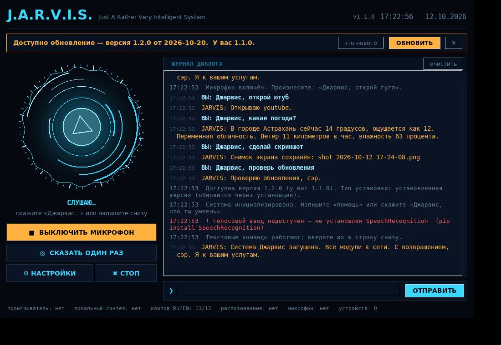

# J.A.R.V.I.S. — голосовой помощник для компьютера

Настольное приложение: слушает ваш голос, выполняет команды на компьютере и отвечает на вопросы.
Говорит озвученными фразами в стиле Джарвиса, понимает **русский и английский**,
работает на **Windows, macOS и Linux**. Есть установщик и обновление по воздуху через GitHub.



---

## 1. Установка

### Вариант А — готовый установщик (проще всего)

Скачайте со страницы **Releases** вашего репозитория:

| Система | Файл | Что делать |
|---|---|---|
| **Windows** | `JARVIS-Setup-X.Y.Z.exe` | Запустить. Ставится без прав администратора, появится ярлык |
| **Windows** (без установки) | `JARVIS-X.Y.Z-windows-portable.zip` | Распаковать, запустить `JARVIS.exe` |
| **macOS** | `JARVIS-X.Y.Z-macos.dmg` | Перетащить в Программы. Первый запуск: правый клик → «Открыть» |
| **Linux** | `JARVIS-X.Y.Z-linux-x86_64.tar.gz` | `tar xzf ... && ./JARVIS/install.sh` |

Файлы можно сверить с `SHA256SUMS.txt` из того же релиза.

### Вариант Б — запуск из исходников

**Windows:** установите [Python 3.10+](https://www.python.org/downloads/)
(галочка **«Add Python to PATH»** обязательна) и запустите **`run.bat`**.

**macOS / Linux:**
```bash
cd jarvis && chmod +x run.sh && ./run.sh
```

**Вручную:**
```bash
python -m venv .venv
# Windows: .venv\Scripts\activate   |   macOS/Linux: source .venv/bin/activate
pip install -r requirements.txt
python main.py
```

> Приложение **запустится даже без установленных пакетов** — будет работать ввод
> с клавиатуры вместо микрофона. Что доступно, видно в строке состояния внизу окна.

Диагностика: `python main.py --check`

---

## 2. Как пользоваться

1. Нажмите **«ВКЛЮЧИТЬ МИКРОФОН»**.
2. Скажите: **«Джарвис, открой гугл»**.

| Способ | Когда удобен |
|---|---|
| **Постоянное прослушивание** | Основной режим. Нужно обращение «Джарвис» перед командой |
| **«Сказать один раз»** | Разовая команда, имя произносить не нужно |
| **Поле ввода снизу** | Без микрофона, тихо, или для проверки команд |

**Режим диалога.** После обращения «Джарвис» помощник 12 секунд слушает без имени:
*«Джарвис»* → *«Да, сэр?»* → *«открой ютуб»* → *«сделай тише»*.

**Прервать речь:** «стоп» или кнопка **СТОП**.

---

## 3. Что он умеет

### Открыть и запустить
```
Джарвис, открой гугл / ютуб / вконтакте / почту / википедию / гитхаб / карты
Джарвис, открой блокнот / калькулятор / проводник / терминал / диспетчер задач
Джарвис, открой папку загрузки / документы / рабочий стол
Джарвис, найди в гугле рецепт плова      Джарвис, загугли курс доллара
Джарвис, включи на ютубе AC/DC           Jarvis, open youtube
```

### Управление компьютером
```
Джарвис, громкость больше / тише / выключи звук
Джарвис, сделай скриншот                 (в Изображения/JarvisShots)
Джарвис, сверни все окна / закрой окно
Джарвис, пауза / следующий трек
Джарвис, заблокируй компьютер / спящий режим
Джарвис, напечатай привет как дела       (вставит текст в активное окно)
Джарвис, выключи компьютер               → спросит подтверждение
Джарвис, отмени выключение
```

### Вопросы
```
Джарвис, который час?            Джарвис, какое сегодня число?
Джарвис, какая погода?           погода в Москве
Джарвис, сколько будет 15 умножить на 7?
Джарвис, что такое квазар?       кто такой Тесла?
Джарвис, состояние системы
```

### Прочее
```
Джарвис, поставь таймер на 10 минут
Джарвис, запиши заметку купить хлеб   /  прочитай заметки
Джарвис, подбрось монетку  /  кинь кубик  /  расскажи анекдот
Джарвис, проверь обновления           Джарвис, какая у тебя версия?
Джарвис, что ты умеешь                Джарвис, стоп / отключись
```

---

## 4. Автообновление через GitHub

Приложение само следит за новыми версиями в вашем репозитории.

### Настройка (один раз)

Этот репозиторий уже привязан: `update_repo` в `core/config.py` и ссылки
в `build/installer.iss` указывают на `UsmanMusav/jarvis` — обновления работают
сразу после установки, настраивать ничего не нужно.

Делаете форк или свой репозиторий — привяжите его заново:

**1.** Создайте **пустой** репозиторий: [github.com/new](https://github.com/new)
— без README и без .gitignore, они уже есть в проекте.

> Репозиторий должен быть **публичным**. Автообновление ходит в GitHub API без
> токена, а для приватного репозитория API отвечает 404 — обновления работать не будут.

**2.** Запустите скрипт привязки, подставив свой адрес:

```bash
# macOS / Linux
chmod +x tools/setup_github.sh
tools/setup_github.sh ваш-логин/jarvis
```
```bat
rem Windows
tools\setup_github.bat ваш-логин/jarvis
```

Скрипт сам подставит ваш адрес в `README.md`, `build/installer.iss` и
`core/config.py`, прогонит тесты, сделает первый коммит, зальёт проект
и предложит поставить тег — после чего GitHub соберёт установщики.

<details>
<summary>То же самое вручную</summary>

```bash
python tools/_patch_repo.py ваш-логин/jarvis   # подставить адрес в файлы
git init && git add -A
git commit -m "J.A.R.V.I.S. 1.1.0"
git branch -M main
git remote add origin https://github.com/ваш-логин/jarvis.git
git push -u origin main
git tag v1.1.0 && git push origin v1.1.0       # запустить сборку релиза
```
</details>

**3.** Готово. Раз в сутки приложение проверит релизы и покажет баннер
с кнопкой «Обновить». Адрес можно поменять в любой момент:
**⚙ Настройки → Обновления → Репозиторий**.


### Как выпустить новую версию

```bash
# 1. поднимите номер версии
#    core/version.py  ->  __version__ = "1.2.0"

git add -A && git commit -m "Версия 1.2.0"
git tag v1.2.0
git push && git push origin v1.2.0
```

Дальше GitHub Actions всё сделает сам (файл `.github/workflows/release.yml`):

1. прогонит тесты на Windows, macOS и Linux;
2. соберёт установщик `.exe`, образ `.dmg` и архив `.tar.gz`;
3. посчитает SHA256;
4. опубликует релиз с этими файлами.

Через сутки (или сразу по кнопке «Проверить обновления») пользователи увидят баннер.

### Что происходит при нажатии «Обновить»

| Как установлено | Что делает обновлятор |
|---|---|
| Установщиком на Windows | Качает `Setup.exe`, запускает его в тихом режиме, приложение закроется и откроется заново |
| Портативная версия | Качает архив, распаковывает, подменяет файлы после выхода и перезапускается |
| Из git-репозитория | `git pull --ff-only` |
| macOS | Качает `.dmg` и открывает его — перетащите в Программы |

Если в релизе есть `SHA256SUMS.txt`, контрольная сумма проверяется до установки;
при несовпадении обновление отменяется.

Из терминала: `python main.py --update`

### Настройки обновления

| Параметр | Смысл |
|---|---|
| `update_repo` | `логин/название` на GitHub. Пусто — проверка выключена |
| `update_check_on_start` | Проверять при запуске (не чаще раза в сутки) |
| `update_auto_install` | Ставить сразу, не спрашивая |
| `update_interval_hours` | Как часто проверять, по умолчанию 24 |
| `update_prereleases` | Предлагать бета-версии |

---

## 5. Сборка установщиков самому

Нужны: Python 3.10+, а для Windows ещё
[Inno Setup 6](https://jrsoftware.org/isdl.php) (`winget install JRSoftware.InnoSetup`).

```bash
# Windows
build\build_windows.bat

# macOS
chmod +x build/build_macos.sh && build/build_macos.sh

# Linux
chmod +x build/build_linux.sh && build/build_linux.sh
```

Результат появится в `dist/`. Скрипты сами создают окружение сборки,
ставят PyInstaller, собирают бинарник, пакуют и считают контрольные суммы.

Подписи кода нет, поэтому Windows SmartScreen при первом запуске скажет
«Неизвестный издатель» → «Подробнее» → «Выполнить в любом случае».
На macOS: правый клик по приложению → «Открыть».

---

## 6. Голос

Двухуровневая схема:

1. **Готовые клипы** — `assets/voice_ru/` и `assets/voice_en/`, по 12–13 реплик на язык:
   `boot`, `welcome`, `wake`, `ack`, `done`, `busy`, `confirm`, `unknown`,
   `error`, `standby`, `shutdown`, `update`, `updated`.
2. **Локальный синтез** — для всего остального (погода, цифры, ответы). Работает оффлайн.

### Добавить свою фразу
1. Положите `.wav` в `assets/voice_ru/` с именем-ключом, например `error.wav`.
2. Допишите ключ и текст в `assets/voices.json`.
3. Прогоните `python tools/polish_clips.py` — он добавит мягкое затухание, чтобы не щёлкало.

Инструменты в `tools/`: `split_clips.py` режет длинную запись на отдельные
фразы по паузам, `polish_clips.py` приводит клипы к одному виду.

### Более живой голос для остального текста
```bash
pip install edge-tts
```
Затем в настройках выберите **«нейросетевой edge-tts»** — бесплатно, без ключа, нужен интернет.
Голоса меняются в `config.json`: `edge_voice_ru`, `edge_voice_en`.

### Голос звучит «роботом»
Это системный синтезатор:
* **Windows** — поставьте русский голос в *Параметры → Время и язык → Речь*,
  затем впишите подсказку (например `Pavel`) в настройках.
* **Linux** — `sudo apt install espeak-ng`.
* Либо включите `edge-tts`.

---

## 7. Настройки

Кнопка **⚙ НАСТРОЙКИ** или файл `config.json`.
У версии из установщика он лежит в `%APPDATA%\Jarvis` (Windows),
`~/Library/Application Support/Jarvis` (macOS), `~/.config/jarvis` (Linux);
у запуска из исходников — рядом с `main.py`. Кнопка «Открыть config.json» покажет точный путь.

| Параметр | Смысл |
|---|---|
| `language` | `auto` / `ru` / `en` |
| `require_wake_word` | Требовать «Джарвис» перед командой |
| `wake_words` | Варианты имени — распознавание часто слышит «жарвис», «дарвис» |
| `follow_up_window` | Сколько секунд слушать без имени после обращения |
| `energy_threshold` | Чувствительность. Ловит шум → увеличьте; не слышит → уменьшите |
| `stt_engine` | `google` (точнее) или `vosk` (полный оффлайн) |
| `tts_engine` | `auto` / `clips` / `pyttsx3` / `edge` |
| `city` | Город для погоды |
| `custom_apps`, `custom_sites` | Свои программы и сайты, см. ниже |

### Свои команды без программирования
```json
{
  "custom_apps": {
    "фотошоп": "C:/Program Files/Adobe/Adobe Photoshop 2024/Photoshop.exe"
  },
  "custom_sites": {
    "работу": "https://mail.google.com",
    "музыку": "https://music.yandex.ru"
  }
}
```
Работает сразу: «Джарвис, открой фотошоп», «Джарвис, включи музыку».

---

## 8. Полностью оффлайн

1. `pip install vosk sounddevice`
2. Скачайте модель с [alphacephei.com/vosk/models](https://alphacephei.com/vosk/models)
   (`vosk-model-small-ru-0.22` — 45 МБ, или `vosk-model-ru-0.42` — 1.8 ГБ, точнее).
3. Укажите путь к распакованной папке в настройках, движок → **Vosk**.

Без интернета перестанут работать только погода, Википедия и автообновление.

---

## 9. Если что-то не работает

**Не ставится PyAudio**
* Windows: `pip install pipwin` → `pipwin install pyaudio`
* Linux: `sudo apt install portaudio19-dev python3-pyaudio`
* macOS: `brew install portaudio` → `pip install PyAudio`

**Не слышит** — проверьте выбранный микрофон, уменьшите `energy_threshold` до 150–200,
дайте приложению доступ к микрофону в настройках системы.

**Срабатывает на шум** — увеличьте `energy_threshold` до 600–1000.

**Не узнаёт имя** — нераспознанные фразы пишутся в журнал серым с пометкой `(мимо)`.
Возьмите оттуда реальный вариант и добавьте в `wake_words`.

**Нет звука** — `pip install pygame`, проверка: `python main.py --say "Проверка связи, сэр"`

**Не открывается окно** — `python main.py --console`

**Обновление не находится** — проверьте `update_repo`, наличие опубликованного
(не черновика) релиза и что в нём есть файл под вашу ОС.

---

## 10. Режимы запуска

```bash
python main.py              # окно
python main.py --console    # терминал
python main.py --check      # диагностика
python main.py --say "..."  # проверка звука
python main.py --update     # обновление из GitHub
python main.py --version    # версия
```

---

## 11. Структура проекта

```
jarvis/
├── main.py                   точка входа и режимы запуска
├── requirements.txt
├── run.bat / run.sh          запуск из исходников в один клик
├── core/
│   ├── version.py            номер версии — её читают сборка и обновлятор
│   ├── ui.py                 интерфейс HUD на tkinter
│   ├── assistant.py          активационное слово, язык, маршрутизация
│   ├── speech.py             распознавание речи (Google / Vosk)
│   ├── audio_out.py          голос: клипы + локальный синтез + edge-tts
│   ├── commands.py           действия на компьютере
│   ├── brain.py              ответы: время, погода, математика, Википедия
│   ├── updater.py            автообновление через GitHub Releases
│   └── config.py             настройки и пути
├── assets/
│   ├── voices.json           карта «ключ → фраза»
│   ├── voice_ru/ voice_en/   клипы голосом Джарвиса (.wav)
│   └── icons/                иконки приложения (.ico, .icns, .png)
├── build/
│   ├── jarvis.spec           сборка PyInstaller
│   ├── installer.iss         установщик Windows (Inno Setup)
│   └── build_windows.bat · build_macos.sh · build_linux.sh
├── tools/
│   ├── setup_github.sh · setup_github.bat   привязка к вашему репозиторию
│   ├── split_clips.py        нарезка озвучки на фразы по паузам
│   └── polish_clips.py       затухание и паддинг клипов
├── tests/                    82 проверки, сеть не нужна
└── .github/workflows/
    ├── tests.yml             тесты на каждый push
    └── release.yml           сборка и публикация релиза по тегу
```

Тесты (действия заглушены, ничего реально не запускается):
```bash
python tests/test_commands.py    # 45 проверок распознавания команд
python tests/test_assistant.py   # 14 проверок логики диалога
python tests/test_updater.py     # 23 проверки автообновления
```

---

## 12. Как добавить свою команду в код

`core/commands.py`, функция `handle()`:

```python
if re.search(r"(открой мой проект|запусти проект)", t):
    open_path(Path.home() / "projects" / "myapp")
    return Reply("Открываю ваш проект, сэр.", "ack")
```

`Reply(text, clip_key)` — `text` озвучивается, а `clip_key`
(`ack`, `done`, `busy`, `unknown`, `error`) проигрывает готовый клип голосом Джарвиса.
